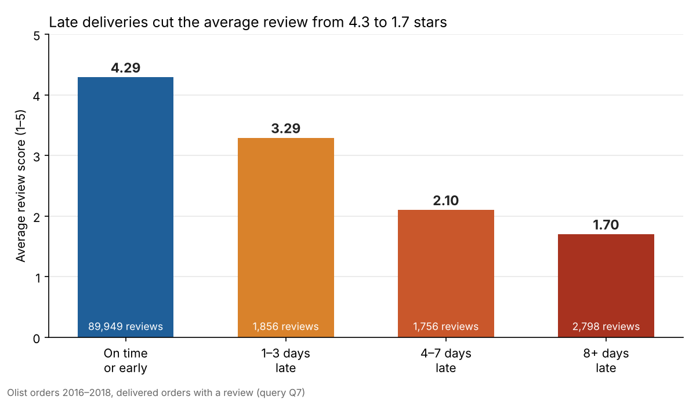

# Olist E-commerce Analytics: SQL + Tableau

Analysis of about 100,000 orders from Olist, a Brazilian e-commerce marketplace, from 2016 to 2018. Thirteen SQL queries answer business questions on growth, delivery, customer retention, payments and sellers, and an interactive Tableau dashboard presents the results with recommendations.

**Live dashboard:** [Tableau Public](https://public.tableau.com/views/Olist_Ecommerce_Dashboard_17934069735120/Recommendations)

## Key findings

- **Revenue more than doubled:** January–August 2018 revenue reached R$7.39M against R$3.11M a year earlier (+137%). Orders peaked in November 2017 (Black Friday) at 7,451, then levelled off at 6,000–7,000 a month in 2018.
- **Late delivery is the main driver of bad reviews:** orders delivered on time average 4.29 stars, while orders 8+ days late average 1.70, and 79% of them get 1 or 2 stars.
- **Delivery is weakest in the North-East:** 91.9% of orders arrive on time nationally, but only 80.3% in Maranhão, 84.7% in Ceará and 86.0% in Bahia.
- **Retention is the weak spot:** only 3.1% of customers order a second time. Repeat customers spend R$260 each against R$138 for one-time buyers, yet bring just 5.7% of revenue.
- **Revenue is concentrated:** the top 10% of sellers (310) generate 67.6% of revenue, and the top three categories (health & beauty, watches & gifts, bed & bath) make up 25.8%.
- **Seller supply lags demand in some states:** Pernambuco and Bahia have about 180 orders per seller, against 75 in Rio de Janeiro, making them priorities for seller recruitment.
- **Instalments lift basket size:** credit card covers 76.9% of orders, and payments split into 7+ instalments average R$335 against R$96 for single payments.

## SQL techniques

- Joins linking all eight tables: orders, customers, order items, products, categories, payments, reviews and sellers
- Common table expressions to build the analysis step by step
- Window functions: `LAG` for month-over-month growth, `NTILE` for seller deciles, `SUM() OVER` for shares and running totals
- `CASE` bucketing for delivery delays, instalments and customer types
- Date arithmetic with `julianday` and `strftime`

All queries and their full output are in [`queries.sql`](queries.sql) and [`results.md`](results.md).

## Data notes

- **On-time rate:** 91.9% is measured over delivered orders. Counting undelivered orders as late gives 89.2%, the figure shown in the dashboard KPI.
- **Year-over-year growth** compares January–August only, because September 2018 contains just 16 orders. Including September gives a misleading +97.6%.
- **Revenue** is the sum of item prices, excluding freight.

## Tableau dashboard

The [interactive dashboard](https://public.tableau.com/views/Olist_Ecommerce_Dashboard_17934069735120/Recommendations), built in Tableau, has 10 pages: revenue trend and forecast, category and payment analysis, delivery time map, review drivers, customer retention, seller concentration, a storytelling page and recommendations. It uses calculated fields such as YoY growth, on-time rate, delay groups and level-of-detail expressions for repeat customers.

## How to run

1. Download the [Brazilian E-Commerce Public Dataset by Olist](https://www.kaggle.com/datasets/olistbr/brazilian-ecommerce) from Kaggle and place the CSV files in a `data/` folder.
2. Install the requirements: `pip install pandas tabulate`
3. Load the data into SQLite: `python load_data.py`
4. Run all queries and write the results: `python run_queries.py`

## Files

| File | Contents |
|---|---|
| `queries.sql` | 13 business questions in SQL (SQLite) |
| `results.md` | output of every query |
| `load_data.py` | loads the Kaggle CSV files into `olist.db` |
| `run_queries.py` | runs `queries.sql` and writes `results.md` |
| `delivery_vs_review.png` | chart of review score by delivery delay |

## Author

Mạc Hải Nam
